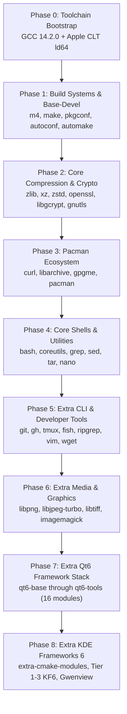

# Arch Linux Darwin Port: Package Inventory & Master Build Roadmap

> [!IMPORTANT]
> **STATUS: PLANNING & ARCHITECTURE SPECIFICATION ONLY — DO NOT BUILD YET**
> 
> **Primary Architecture Target:** Intel Mac (`darwin_x86_64` / `x86_64-apple-darwin24`)
> **Secondary Architecture Target:** Apple Silicon Mac (`darwin_arm64` / `arm64-apple-darwin24`)
> **Installation Root Prefix:** `/opt/pacman`

---

## 1. Executive Summary & Repository Audit

This document provides an exhaustive inventory of all 140 software packages tracked in the Arch Linux macOS port, comparing each package against the official upstream Arch Linux repository distribution model (`core` vs `extra`).

### Key Metrics

| Metric | Count | Details |
| :--- | :--- | :--- |
| **Total Tracked Packages** | **140** | Across binary repos, source PKGBUILDs, and build scripts |
| **Upstream Arch Linux `core`** | **68** | Fundamental base system, toolchain, runtime, and pacman stack |
| **Upstream Arch Linux `extra`** | **71** | Extended CLI tools, development runtimes, Qt6, and KDE Frameworks |
| **Custom / Darwin-Specific** | **1** | `sitecheck` (Darwin repo & site integrity validator) |
| **Intel (`darwin_x86_64`) Binary Availability** | **139 / 140** | 99.3% binary coverage (1 pkg provided via alias: pkg-config -> pkgconf) |
| **Apple Silicon (`darwin_arm64`) Binary Availability** | **122 / 140** | 87.1% binary coverage |
| **Packages with Dual Architecture Binaries** | **121** | Both Intel and Apple Silicon tarballs ready in repo |
| **Intel-Exclusive Packages (Missing Silicon)** | **18** | Includes native GCC 14.2.0, readline 8.3, gnutls 3.8.13, etc. |
| **Repository Misplacements** | **7** | Packages residing in local extra that belong in upstream core |
| **Repository Duplicates** | **1** | `brotli` currently present in both local `core` and `extra` |

---

### 1.1 Upstream Arch Linux Repository Scale vs Darwin Port

To provide perspective on the port scope, the table below compares the official upstream Arch Linux package database (`archlinux.org/packages`) against this Darwin port:

| Repository Tier | Upstream Arch Linux (x86_64) | Arch Darwin Port | Architecture & Porting Scope Notes |
| :--- | :---: | :---: | :--- |
| **`core`** | **258** | **68** | Upstream includes Linux kernel (`linux`), `systemd`, `kmod`, `iptables`, `e2fsprogs`, and firmware. The Darwin port retains the complete POSIX userspace, GNU compiler toolchain, base-devel, and pacman stack, while relying on Apple's Mach-O kernel (XNU) and Darwin system frameworks. |
| **`extra`** | **10,063** | **71** | Upstream contains the full desktop/application catalog. The Darwin port currently focuses on essential developer tooling (`git`, `tmux`, `fish`, `vim`, `ripgrep`, `imagemagick`), the complete Qt6 framework stack (16 modules), and KDE Frameworks 6 (27 libraries). |
| **`multilib`** | **184** | **0** | Legacy 32-bit Linux binary support (`i686`). Omitted entirely on Darwin because macOS Catalina (10.15) and later dropped 32-bit executable support. |
| **`testing` (all tiers)** | **263** | **0** | Upstream pre-release staging (`core-testing`: 12, `extra-testing`: 248, `multilib-testing`: 3). |
| **Total Official Stable** | **10,505** | **139** | Full official stable repository footprint. |
| **AUR (User Repository)** | **85,000+** | **N/A** | Community-submitted source PKGBUILD recipes. |

---

### 1.2 Live Sync Database Audit (`pacman -Ss`)

A verification of the live pacman sync databases (`core.db` and `extra.db`) via `/opt/pacman/bin/pacman -Ss` confirms:

- **Total Search Entries in `pacman -Ss`:** **140 entries**
- **Total Unique Package Names in `pacman -Ss`:** **139 packages**
- **Inventory Reconciliation:**
  1. **139 of 140 packages** are directly indexed and searchable via `pacman -Ss`.
  2. **`brotli`** appears twice (indexed under both `core/brotli` and `extra/brotli`), which accounts for 140 search entries across 139 unique package names.
  3. **`pkg-config`** is the only named entry not having its own distinct package record because it is provided virtually by `core/pkgconf` (which supplies the `pkg-config` binary and symlinks), fully satisfying dependent packages.

---

## 2. Upstream Alignment & Repository Realignment Plan

In official Arch Linux (post-2023 `community` repo merger):
- **`core` Repository:** Houses the minimal, fully self-hosting base system. It includes the compiler toolchain (`gcc`), core build utilities (`make`, `autoconf`, `automake`, `pkgconf`), system shells (`bash`), text processing (`sed`, `grep`, `gawk`), basic editors (`nano`), crypto/compression libraries, and `pacman`.
- **`extra` Repository:** Houses user-facing CLI utilities (`git`, `tmux`, `fish`, `ripgrep`, `vim`), languages, image processing (`imagemagick`), application frameworks (`qt6`), and desktop environments (`kf6`).

### Detected Discrepancies & Migration Actions

The following table outlines the 8 packages requiring repository relocation to achieve 100% parity with upstream Arch Linux:

| Package | Current Local Repo | Upstream Arch Repo | Issue & Action Required |
| :--- | :--- | :--- | :--- |
| `gcc` | `extra` | **`core`** | **Misplaced:** Move binary package and sync database entry to `core` |
| `json-c` | `extra` | **`core`** | **Misplaced:** Move binary package and sync database entry to `core` |
| `libevent` | `extra` | **`core`** | **Misplaced:** Move binary package and sync database entry to `core` |
| `links` | `extra` | **`core`** | **Misplaced:** Move binary package and sync database entry to `core` |
| `nano` | `extra` | **`core`** | **Misplaced:** Move binary package and sync database entry to `core` |
| `pinentry` | `extra` | **`core`** | **Misplaced:** Move binary package and sync database entry to `core` |
| `xxhash` | `core` | **`extra`** | **Misplaced:** Move binary package and sync database entry to `extra` |
| `brotli` | `core, extra` | **`core`** | **Duplicate:** Remove from `extra/`, retain in `core/` |

> [!NOTE]
> **Source Tree Reorganization (`packages/`):**
> Currently, all 98 PKGBUILD recipes exist inside `packages/extra/` (even for core packages like `bash`, `coreutils`, and `pacman`).
> A clean step for the repository structure is to split the source directory into:
> - `packages/core/` (68 packages)
> - `packages/extra/` (71 packages)
> - `packages/custom/` (`sitecheck`)

---

## 3. Comprehensive Package Inventory

### 3.1 Upstream `core` Packages (68 Packages)

| Package | Arch Repo | Local Repo | Intel (`x86_64`) | Silicon (`arm64`) | PKGBUILD | Description / Role |
| :--- | :---: | :---: | :---: | :---: | :---: | :--- |
| `autoconf` | `core` | `core` | 2.73-1 | -- | Yes | A GNU tool for automatically configuring source code |
| `automake` | `core` | `core` | 1.19-1 | 1.16.5-1 | Yes | A GNU tool for automatically creating Makefiles |
| `base` | `core` | `core` | 2026.11.22-1 | 2026.11.22-1 | Recipe/Script | Minimal package set to define a basic Arch Darwin installation |
| `base-devel` | `core` | `core` | 2026.11.23-1 | 2026.11.23-1 | Recipe/Script | Basic tools to build Arch Darwin packages (GCC, make, etc.) |
| `bash` | `core` | `core` | 5.3-1 | 5.3.15-1 | Yes | The GNU Bourne Again shell |
| `brotli` | `core` | `core, extra` | 1.2.1-1 | 1.2.0-1 | Yes | Generic-purpose lossless compression algorithm |
| `bzip2` | `core` | `core` | 1.0.8-1 | 1.0.8-1 | Yes | A high-quality data compression program |
| `ca-certificates` | `core` | `core` | 2026.10.20-1 | 2026.07.16-1 | Yes | Common CA certificates - default providers |
| `coreutils` | `core` | `core` | 9.6-1 | 9.5-1 | Yes | The basic file, shell and text manipulation utilities of the GNU operating system |
| `curl` | `core` | `core` | 8.12.0-1 | 8.12.0-1 | Recipe/Script | command line tool and library for transferring data with URLs |
| `diffutils` | `core` | `core` | 3.12-1 | 3.10-1 | Yes | Utility programs used for creating patch files |
| `expat` | `core` | `core` | 2.6.4-1 | 2.8.2-1 | Yes | An XML parser library |
| `findutils` | `core` | `core` | 4.11.0-1 | 4.9.0-1 | Yes | GNU utilities to locate files |
| `gawk` | `core` | `core` | 5.4.1-1 | 5.4.1-1 | Yes | GNU version of awk |
| `gcc` | `core` | `extra` | 14.2.0-1 | -- | Yes | The GNU Compiler Collection - C and C++ frontends |
| `gettext` | `core` | `core` | 0.22.5-1 | 1.0-1 | Yes | GNU internationalization library |
| `gmp` | `core` | `core` | 6.3.0-1 | 6.3.0-1 | Yes | A free library for arbitrary precision arithmetic |
| `gnupg` | `core` | `core` | 2.5.24-2 | 2.5.21-1 | Yes | Complete and free implementation of the OpenPGP standard |
| `gnutls` | `core` | `core` | 3.8.13-3 | -- | Yes | A library which provides a secure layer over a reliable transport layer |
| `gpgme` | `core` | `core` | 1.24.2-1 | 1.24.2-1 | Recipe/Script | C wrapper library for GnuPG |
| `grep` | `core` | `core` | 3.12-1 | 3.11-1 | Yes | A string search utility |
| `gzip` | `core` | `core` | 1.15-1 | 1.13-1 | Yes | GNU compression utility |
| `json-c` | `core` | `extra` | 0.19-1 | 0.19-1 | Yes | JSON implementation in C |
| `krb5` | `core` | `core` | 1.22.2-3 | 1.22.2-1 | Yes | The Kerberos network authentication system |
| `less` | `core` | `core` | 668-1 | 643-1 | Yes | A terminal based program for viewing text files |
| `libarchive` | `core` | `core` | 3.7.7-1 | 3.7.7-1 | Recipe/Script | Multi-format archive and compression library |
| `libassuan` | `core` | `core` | 3.0.2-1 | -- | Yes | IPC library used by some GnuPG related software |
| `libevent` | `core` | `extra` | 2.1.12-1 | 2.1.13-1 | Yes | Event notification library |
| `libffi` | `core` | `core` | 3.4.6-1 | 3.7.1-1 | Yes | Portable foreign function interface library |
| `libgcrypt` | `core` | `core` | 1.11.0-1 | -- | Yes | General purpose cryptographic library based on the code from GnuPG |
| `libgpg-error` | `core` | `core` | 1.61-1 | -- | Yes | Support library for libgcrypt |
| `libidn2` | `core` | `core` | 2.3.7-1 | 2.3.8-1 | Yes | Free software implementation of IDNA2008, Punycode and TR46 |
| `libksba` | `core` | `core` | 1.6.7-1 | -- | Yes | Library for working with X.509 certificates, CMS data and related objects |
| `libpipeline` | `core` | `core` | 1.5.8-1 | 1.5.8-1 | Yes | a C library for manipulating pipelines of subprocesses in a flexible and convenient way |
| `libpsl` | `core` | `core` | 0.21.5-1 | 0.23.0-1 | Yes | Public Suffix List library |
| `libtasn1` | `core` | `core` | 4.19.0-1 | -- | Yes | The ASN.1 library used in GNUTLS |
| `libunistring` | `core` | `core` | 1.2-1 | 1.4.2-1 | Yes | Library for manipulating Unicode strings and C strings |
| `libusb` | `core` | `core` | 1.0.30-1 | 1.0.30-1 | Yes | Library that provides generic access to USB devices |
| `libxcrypt` | `core` | `core` | 4.5.2-1 | 4.5.2-1 | Yes | Modern library for one-way hashing of passwords |
| `libxml2` | `core` | `core` | 2.13.4-1 | 2.15.3-1 | Yes | XML C parser and toolkit |
| `links` | `core` | `extra` | 2.30-2 | 2.30-1 | Yes | A text WWW browser, similar to Lynx |
| `lz4` | `core` | `core` | 1.10.0-1 | 1.10.0-1 | Yes | Extremely fast compression algorithm |
| `lzo` | `core` | `core` | 2.10-1 | 2.10-1 | Yes | Portable lossless data compression library |
| `m4` | `core` | `core` | 1.4.20-1 | -- | Yes | The GNU macro processor |
| `make` | `core` | `core` | 4.4.1-1 | 4.4.1-1 | Yes | GNU make utility to maintain groups of programs |
| `mpfr` | `core` | `core` | 4.2.1-1 | -- | Yes | Multiple-precision floating-point library |
| `nano` | `core` | `extra` | 9.1-1 | 9.1-1 | Yes | Pico editor clone with enhancements |
| `ncurses` | `core` | `core` | 6.5-1 | 6.6-1 | Yes | System V Release 4.0 curses emulation library |
| `nettle` | `core` | `core` | 3.10-1 | -- | Yes | A low-level cryptographic library |
| `npth` | `core` | `core` | 1.7-1 | -- | Yes | The new GNU portable threads library |
| `openssl` | `core` | `core` | 3.4.1-1 | 3.6.3-1 | Yes | The Open Source toolkit for cryptography and Transport Layer Security |
| `p11-kit` | `core` | `core` | 0.26.5-1 | 0.26.4-1 | Yes | Loads and enumerates PKCS#11 modules |
| `pacman` | `core` | `core` | 7.1.0-1 | 7.1.0-1 | Yes | A library-based package manager with dependency support |
| `pacman-mirrorlist` | `core` | `core` | 2026.11.22-1 | 2026.11.22-1 | Recipe/Script | Arch Darwin Pacman mirror list configuration |
| `pcre2` | `core` | `core` | 10.45-1 | 10.47-2 | Yes | A library that implements Perl 5-style regular expressions. 2nd version |
| `pinentry` | `core` | `extra` | 1.3.3-1 | -- | Yes | Collection of simple PIN or passphrase entry dialogs which utilize the Assuan protocol |
| `pkg-config` | `core` | `core` | -- | 0.29.2-1 | Recipe/Script | Package compiler and linker metadata tool (provided by pkgconf) |
| `pkgconf` | `core` | `core` | 2.3.0-1 | 3.0.3-1 | Yes | Package compiler and linker metadata toolkit |
| `popt` | `core` | `core` | 1.19-1 | 1.19-1 | Yes | A commandline option parser |
| `readline` | `core` | `core` | 8.3-1 | -- | Yes | GNU readline library |
| `sed` | `core` | `core` | 4.10-1 | 4.9-1 | Yes | GNU stream editor |
| `sqlite` | `core` | `core` | 3.47.0-1 | 3.53.3-1 | Yes | A C library that implements an SQL database engine |
| `tar` | `core` | `core` | 1.35-2 | 1.35-1 | Yes | Utility used to store, backup, and transport files |
| `texinfo` | `core` | `core` | 7.3-2 | 7.3-1 | Yes | GNU documentation system for on-line information and printed output |
| `which` | `core` | `core` | 2.21-1 | -- | Recipe/Script | A utility to show the full path of commands |
| `xz` | `core` | `core` | 5.6.4-1 | 5.8.3-1 | Yes | Library and command line tools for XZ and LZMA compressed files |
| `zlib` | `core` | `core` | 1.3.1-1 | 1.3.2-1 | Yes | Compression library implementing the deflate compression method found in gzip and PKZIP |
| `zstd` | `core` | `core` | 1.5.7-1 | 1.5.7-2 | Yes | Zstandard - Fast real-time compression algorithm |

### 3.2 Upstream `extra` Packages (71 Packages)

| Package | Arch Repo | Local Repo | Intel (`x86_64`) | Silicon (`arm64`) | PKGBUILD | Description / Role |
| :--- | :---: | :---: | :---: | :---: | :---: | :--- |
| `breeze-icons` | `extra` | `extra` | 6.31.0-1 | 6.31.0-1 | Recipe/Script | Breeze icon theme |
| `exiv2` | `extra` | `extra` | 0.28.9-1 | 0.28.9-1 | Recipe/Script | Exif, Iptc and XMP metadata manipulation library and tools |
| `extra-cmake-modules` | `extra` | `extra` | 6.31.0-1 | 6.31.0-1 | Recipe/Script | Extra modules and scripts for CMake |
| `fastfetch` | `extra` | `extra` | 2.70.0-1 | 2.66.0-1 | Yes | A feature-rich and performance oriented neofetch like system information tool |
| `fd` | `extra` | `extra` | 10.5.0-1 | 10.4.2-1 | Yes | Simple, fast and user-friendly alternative to find |
| `fish` | `extra` | `extra` | 4.9.3-1 | 4.9.3-1 | Yes | Smart and user friendly shell intended mostly for interactive use |
| `fzf` | `extra` | `extra` | 0.74.5-1 | 0.74.0-1 | Yes | Command-line fuzzy finder |
| `gh` | `extra` | `extra` | 2.103.3-1 | -- | Yes | The GitHub CLI (upstream package: github-cli) |
| `git` | `extra` | `extra` | 2.56.0-3 | 2.55.0-1 | Yes | the fast distributed version control system |
| `gwenview` | `extra` | `extra` | 26.08.2-1 | 26.08.2-1 | Recipe/Script | A fast and easy to use image viewer |
| `imagemagick` | `extra` | `extra` | 7.1.2.36-1 | -- | Yes | An image viewing/manipulation program |
| `jemalloc` | `extra` | `extra` | 5.4.0-1 | -- | Yes | General-purpose scalable concurrent malloc implementation |
| `jq` | `extra` | `extra` | 1.7.1-1 | 1.8.2-1 | Yes | Command-line JSON processor |
| `karchive` | `extra` | `extra` | 6.31.0-1 | 6.31.0-1 | Recipe/Script | Qt addon providing access to numerous types of archives |
| `kbookmarks` | `extra` | `extra` | 6.31.0-1 | 6.31.0-1 | Recipe/Script | Support for bookmarks and the XBEL format |
| `kcodecs` | `extra` | `extra` | 6.31.0-1 | 6.31.0-1 | Recipe/Script | Provide a collection of methods to manipulate strings using various encodings |
| `kcolorscheme` | `extra` | `extra` | 6.31.0-1 | 6.31.0-1 | Recipe/Script | Classes to read and interact with KColorScheme |
| `kcompletion` | `extra` | `extra` | 6.31.0-1 | 6.31.0-1 | Recipe/Script | Text completion helpers and widgets |
| `kconfig` | `extra` | `extra` | 6.31.0-1 | 6.31.0-1 | Recipe/Script | Configuration system |
| `kconfigwidgets` | `extra` | `extra` | 6.31.0-1 | 6.31.0-1 | Recipe/Script | Widgets for KConfig |
| `kcoreaddons` | `extra` | `extra` | 6.31.0-1 | 6.31.0-1 | Recipe/Script | Addons to QtCore |
| `kcrash` | `extra` | `extra` | 6.31.0-1 | 6.31.0-1 | Recipe/Script | Support for application crash analysis and bug report from apps |
| `kdbusaddons` | `extra` | `extra` | 6.31.0-1 | 6.31.0-1 | Recipe/Script | Addons to QtDBus |
| `kguiaddons` | `extra` | `extra` | 6.31.0-1 | 6.31.0-1 | Recipe/Script | Addons to QtGui |
| `ki18n` | `extra` | `extra` | 6.31.0-1 | 6.31.0-1 | Recipe/Script | Advanced internationalization framework |
| `kiconthemes` | `extra` | `extra` | 6.31.0-1 | 6.31.0-1 | Recipe/Script | Support for icon themes |
| `kio` | `extra` | `extra` | 6.31.0-1 | 6.31.0-1 | Recipe/Script | Resource and network access abstraction |
| `kitemmodels` | `extra` | `extra` | 6.31.0-1 | 6.31.0-1 | Recipe/Script | Models for Qt Model/View system |
| `kitemviews` | `extra` | `extra` | 6.31.0-1 | 6.31.0-1 | Recipe/Script | Widget addons for Qt Model/View |
| `kjobwidgets` | `extra` | `extra` | 6.31.0-1 | 6.31.0-1 | Recipe/Script | Widgets for tracking KJob instances |
| `knotifications` | `extra` | `extra` | 6.31.0-1 | 6.31.0-1 | Recipe/Script | Abstraction for system notifications |
| `kparts` | `extra` | `extra` | 6.31.0-1 | 6.31.0-1 | Recipe/Script | Document centric plugin system |
| `kservice` | `extra` | `extra` | 6.31.0-1 | 6.31.0-1 | Recipe/Script | Advanced plugin and service introspection |
| `ktextwidgets` | `extra` | `extra` | 6.31.0-1 | 6.31.0-1 | Recipe/Script | Advanced text editing widgets |
| `kwidgetsaddons` | `extra` | `extra` | 6.31.0-1 | 6.31.0-1 | Recipe/Script | Addons to QtWidgets |
| `kwindowsystem` | `extra` | `extra` | 6.31.0-1 | 6.31.0-1 | Recipe/Script | Access to the windowing system |
| `kxmlgui` | `extra` | `extra` | 6.31.0-1 | 6.31.0-1 | Recipe/Script | User configurable main windows |
| `lcms2` | `extra` | `extra` | 2.20-1 | 2.20-1 | Recipe/Script | Small-footprint color management engine, version 2 |
| `libjpeg-turbo` | `extra` | `extra` | 3.2.1-1 | 3.2.1-1 | Recipe/Script | JPEG image codec with accelerated baseline compression and decompression |
| `libpng` | `extra` | `extra` | 1.6.59-1 | 1.6.59-1 | Recipe/Script | A collection of routines used to create PNG format graphics files |
| `libsodium` | `extra` | `extra` | 1.0.22-1 | 1.0.22-1 | Yes | A modern, portable, easy to use crypto library |
| `libtiff` | `extra` | `extra` | 4.7.2-1 | 4.7.2-1 | Recipe/Script | Library for manipulation of TIFF images |
| `oniguruma` | `extra` | `extra` | 6.9.9-1 | 6.9.10-1 | Yes | A regular expressions library |
| `qt6-base` | `extra` | `extra` | 6.12.0-2 | 6.12.0-2 | Yes | A cross-platform application and UI framework |
| `qt6-connectivity` | `extra` | `extra` | 6.12.0-1 | 6.12.0-1 | Yes | Provides access to Bluetooth hardware |
| `qt6-declarative` | `extra` | `extra` | 6.12.0-1 | 6.12.0-1 | Yes | Classes for QML and JavaScript languages |
| `qt6-imageformats` | `extra` | `extra` | 6.12.0-1 | 6.12.0-1 | Yes | Plugins for additional image formats: TIFF, MNG, TGA, WBMP |
| `qt6-languageserver` | `extra` | `extra` | 6.12.0-1 | 6.12.0-1 | Yes | An implementation of the Language Server Protocol |
| `qt6-lottie` | `extra` | `extra` | 6.12.0-1 | 6.12.0-1 | Yes | A family of player software for a certain json-based file format for describing 2d vector graphics animations |
| `qt6-multimedia` | `extra` | `extra` | 6.12.0-1 | 6.12.0-1 | Yes | Classes for audio, video, radio and camera functionality |
| `qt6-networkauth` | `extra` | `extra` | 6.12.0-1 | 6.12.0-1 | Yes | Network authentication module |
| `qt6-quick3d` | `extra` | `extra` | 6.12.0-1 | 6.12.0-1 | Yes | Qt module and API for defining 3D content in Qt Quick |
| `qt6-quick3dphysics` | `extra` | `extra` | 6.12.0-1 | 6.12.0-1 | Yes | Physics engine integration for Qt Quick 3D |
| `qt6-quicktimeline` | `extra` | `extra` | 6.12.0-1 | 6.12.0-1 | Yes | Qt module for keyframe-based timeline construction |
| `qt6-serialport` | `extra` | `extra` | 6.12.0-1 | 6.12.0-1 | Yes | Provides access to hardware and virtual serial ports |
| `qt6-shadertools` | `extra` | `extra` | 6.12.0-1 | 6.12.0-1 | Yes | Provides functionality for the shader pipeline that allows Qt Quick to operate on Vulkan, Metal, and Direct3D, in addition to OpenGL |
| `qt6-svg` | `extra` | `extra` | 6.12.0-1 | 6.12.0-1 | Yes | Classes for displaying the contents of SVG files |
| `qt6-tools` | `extra` | `extra` | 6.12.0-1 | 6.12.0-1 | Yes | A cross-platform application and UI framework (Development Tools, QtHelp) |
| `qt6-websockets` | `extra` | `extra` | 6.12.0-1 | 6.12.0-1 | Yes | Provides WebSocket communication compliant with RFC 6455 |
| `ripgrep` | `extra` | `extra` | 15.2.0-1 | 15.2.0-1 | Yes | A search tool that combines the usability of ag with the raw speed of grep |
| `rsync` | `extra` | `extra` | 3.5.1-1 | 3.4.4-1 | Yes | A fast and versatile file copying tool for remote and local files |
| `solid` | `extra` | `extra` | 6.31.0-1 | 6.31.0-1 | Recipe/Script | Hardware integration and detection |
| `sonnet` | `extra` | `extra` | 6.31.0-1 | 6.31.0-1 | Recipe/Script | Spelling framework for Qt |
| `tmux` | `extra` | `extra` | 3.8-1 | 3.7b-1 | Yes | Terminal multiplexer |
| `tree` | `extra` | `extra` | 2.2.1-1 | 2.3.2-1 | Yes | A directory listing program displaying a depth indented list of files |
| `utf8proc` | `extra` | `extra` | 2.9.0-1 | 2.11.3-1 | Yes | Clean C library for processing UTF-8 Unicode data (upstream: libutf8proc) |
| `vim` | `extra` | `extra` | 9.2.1250-1 | 9.1.0000-1 | Yes | Vi Improved, a highly configurable, improved version of the vi text editor |
| `wget` | `extra` | `extra` | 1.25.0-3 | 1.25.0-1 | Yes | Network utility to retrieve files from the web |
| `xxhash` | `extra` | `core` | 0.8.2-1 | 0.8.3-1 | Yes | Extremely fast non-cryptographic hash algorithm |
| `yq` | `extra` | `extra` | 4.54.1-1 | 4.53.3-1 | Yes | Command-line YAML, XML, TOML processor - jq wrapper for YAML/XML/TOML documents |
| `yyjson` | `extra` | `extra` | 0.13.0-1 | 0.12.0-1 | Yes | A high performance JSON library written in ANSI C |

### 3.3 Custom & Darwin-Specific Packages (1 Package)

| Package | Arch Repo | Local Repo | Intel (`x86_64`) | Silicon (`arm64`) | PKGBUILD | Description / Role |
| :--- | :---: | :---: | :---: | :---: | :---: | :--- |
| `sitecheck` | `custom-darwin` | `extra` | 1.0.0-1 | 1.0.0-1 | Yes | Antigravity Pacman local repository & site verification tool |

---

## 4. Master Phased Build Roadmap for Intel Mac (`darwin_x86_64`)

To compile all 140 packages clean from upstream source for Intel Mac (`x86_64-apple-darwin`), builds must proceed in strict dependency tier order.



### Phase 0: Host Bootstrap & Native Compiler Toolchain
- **Objective:** Provide a native, self-hosting GNU C/C++ compiler in `/opt/pacman/bin/gcc` and `/opt/pacman/bin/g++`.
- **Status:** **COMPLETED** (GNU GCC 14.2.0 natively compiled and verified on Intel Darwin).
- **Packages:** `gcc` (with `gcc-libs`).
- **Toolchain Integration:**
  - Apple Command Line Tools `/usr/bin/ld` (Mach-O `ld64` / `ld-prime`) handles the final link step.
  - Sysroot set to `$(xcrun --show-sdk-path)` for macOS SDK headers (`MacOSX.sdk`).
  - Legacy 32-bit Darwin symbols pruned from `libgcc/config/darwin-unwind.ver`.

### Phase 1: Core Build System & Meta Packages
- **Objective:** Provide fundamental macro processors, build tools, and dependency trackers.
- **Packages (11):** `m4`, `make`, `pkgconf`, `pkg-config`, `texinfo`, `which`, `autoconf`, `automake`, `diffutils`, `findutils`, `base`, `base-devel`.
- **Build Details:**
  - All tools configure with `--prefix=/opt/pacman`.
  - `base-devel` meta-package depends on `gcc`, `make`, `autoconf`, `automake`, `pkgconf`, `diffutils`, `findutils`, `gawk`, `grep`, `sed`, `tar`, `which`.

### Phase 2: Core Low-Level Compression, Math & Cryptographic Libraries
- **Objective:** Foundation dynamic libraries required by `libarchive`, `curl`, `pacman`, and `git`.
- **Packages (23):**
  - *Compression:* `zlib`, `bzip2`, `xz`, `zstd`, `lz4`, `lzo`.
  - *Math & Memory:* `gmp`, `mpfr`.
  - *String & Charset:* `libunistring`, `libtasn1`, `libidn2`, `libpsl`, `libffi`.
  - *Crypto & Security:* `openssl`, `libgpg-error`, `libgcrypt`, `libassuan`, `libksba`, `npth`, `nettle`, `gnutls`, `p11-kit`, `ca-certificates`.
  - *Data & Parsing:* `expat`, `libxcrypt`, `libxml2`, `sqlite`, `json-c`.
- **Darwin Requirements:**
  - Inject `-Wl,-install_name,/opt/pacman/lib/lib<name>.dylib` and `-Wl,-rpath,/opt/pacman/lib`.
  - Codesign all `.dylib` files with `codesign -f -s -`.

### Phase 3: Pacman Package Management Stack
- **Objective:** Complete native binary package manager with cryptographic signature verification.
- **Packages (6):** `brotli`, `curl`, `libarchive`, `gpgme`, `pacman`, `pacman-mirrorlist`.
- **Build Details:**
  - `curl` compiled with HTTP/2 support, OpenSSL, and Brotli.
  - `libarchive` compiled with zstd, lz4, xz, bzip2, expat, and openssl.
  - `gpgme` compiled against `/opt/pacman` GPG libraries.
  - `pacman` compiled with Meson: `-Dgpgme=enabled`, `-Dc_args="-I/opt/pacman/include"`, `-Dc_link_args="-L/opt/pacman/lib"`.
  - Patched `libalpm/be_package.c` for `LocalFileSigLevel = Optional` detached signature validation.
  - Patched `src/pacman/conf.c` to preserve `.db.sig` files during `-Sy` mirror downloads.

### Phase 4: Core Shells & Essential CLI Utilities
- **Objective:** Interactive user shells and POSIX command-line tools.
- **Packages (17):** `ncurses`, `readline`, `bash`, `coreutils`, `grep`, `sed`, `gawk`, `gzip`, `tar`, `less`, `nano`, `links`, `gnupg`, `pinentry`, `krb5`, `libusb`, `libpipeline`, `popt`, `pcre2`.
- **Build Details:**
  - `ncurses` configured with `--enable-widec --with-shared`.
  - `bash` linked against `/opt/pacman` readline and ncurses.
  - `nano` 9.1 compiled with native GCC, UTF-8 enabled.
  - `coreutils` compiled without Linux-specific `selinux` or `systemd`.

### Phase 5: Extra General Developer CLI Tools & Utilities
- **Objective:** Developer productivity tools, VCS, and modern terminal utilities.
- **Packages (22):** `xxhash`, `utf8proc`, `git`, `gh` (`github-cli`), `tmux`, `fish`, `vim`, `wget`, `ripgrep`, `fd`, `fzf`, `tree`, `jq`, `yq`, `yyjson`, `rsync`, `fastfetch`, `sitecheck`, `jemalloc`, `libsodium`, `oniguruma`, `libevent`.
- **Build Details:**
  - `git` built with curl, expat, zlib, gettext, and OpenSSL.
  - Rust tools (`ripgrep`, `fd`) built via `cargo build --release --target x86_64-apple-darwin`.
  - Go tools (`gh`) built via `go build`.
  - `fish` shell compiled using CMake with PCRE2 and ncurses.

### Phase 6: Extra Media & Graphics Libraries
- **Objective:** Image encoding, decoding, and manipulation libraries.
- **Packages (6):** `libpng`, `libjpeg-turbo`, `libtiff`, `lcms2`, `exiv2`, `imagemagick`.
- **Build Details:**
  - SIMD optimizations enabled for x86_64 (NASM for `libjpeg-turbo`).
  - `imagemagick` linked with OpenMP via native GCC (`-fopenmp`) and all media codecs.

### Phase 7: Extra Qt6 Application Framework
- **Objective:** Complete cross-platform C++ GUI framework for Darwin.
- **Packages (16):**
  1. `qt6-base` (Core, Gui, Widgets, Network, Sql, Apple Metal backend)
  2. `qt6-shadertools`
  3. `qt6-declarative` (QML / Quick engine)
  4. `qt6-svg`
  5. `qt6-imageformats`
  6. `qt6-tools` (Linguist, Designer, QDoc)
  7. `qt6-lottie`
  8. `qt6-multimedia`
  9. `qt6-networkauth`
  10. `qt6-connectivity`
  11. `qt6-serialport`
  12. `qt6-websockets`
  13. `qt6-languageserver`
  14. `qt6-quick3d`
  15. `qt6-quick3dphysics`
  16. `qt6-quicktimeline`
- **Darwin Requirements:**
  - Pass `-DCMAKE_OSX_SYSROOT=$(xcrun --show-sdk-path)`.
  - Framework bundle layout handled via `-DQT_BUILD_FRAMEWORKS=OFF` to match Unix FHS style in `/opt/pacman`.

### Phase 8: Extra KDE Frameworks 6 (KF6) & Desktop Applications
- **Objective:** Full modern KDE 6 libraries and utilities on macOS.
- **Packages (27):**
  - *Build Tool:* `extra-cmake-modules`.
  - *Tier 1:* `kcoreaddons`, `kcodecs`, `kconfig`, `kwidgetsaddons`, `ki18n`, `kguiaddons`, `kitemviews`, `kitemmodels`, `kcolorscheme`, `kwindowsystem`, `kdbusaddons`, `breeze-icons`.
  - *Tier 2:* `karchive`, `kcrash`, `kcompletion`, `knotifications`, `kjobwidgets`, `kservice`, `solid`, `sonnet`.
  - *Tier 3:* `kconfigwidgets`, `ktextwidgets`, `kxmlgui`, `kbookmarks`, `kiconthemes`, `kio`, `kparts`.
  - *Applications:* `gwenview` (KDE image viewer).

---

## 5. Secondary Target: Apple Silicon Mac (`darwin_arm64`) Adaptation

While Intel Mac (`darwin_x86_64`) is the primary build target, all recipes are designed for Apple Silicon (`arm64-apple-darwin`):

### Key Architectural Differences
| Dimension | Intel Mac (`darwin_x86_64`) | Apple Silicon Mac (`darwin_arm64`) |
| :--- | :--- | :--- |
| **Target Triple** | `x86_64-apple-darwin24` | `arm64-apple-darwin24` / `aarch64-apple-darwin24` |
| **Architecture Flag** | `-arch x86_64` | `-arch arm64` |
| **Memory Page Size** | 4 KiB | 16 KiB (requires `--with-pagesize=16384` in jemalloc) |
| **Codesigning** | Recommended (avoids Gatekeeper prompts) | **MANDATORY** (Kernel SIGKILLs unsigned Mach-O binaries) |
| **SIMD Extensions** | SSE2, SSE4.2, AVX2 | ARM Neon, Crypto Extensions |
| **GCC Host Compiler** | Real GNU GCC 14.2.0 | Apple Clang (bootstrap) -> GNU GCC 14.2.0 |

---

## 6. Standardized Darwin Packaging Blueprint & Compilation Rules

When building any package from source in `/opt/pacman`, every PKGBUILD or build script must enforce the following standard rules:

```bash
# Standard Darwin Environment Flags
export PATH="/opt/pacman/bin:/usr/bin:/bin:/usr/sbin:/sbin"
export SDKPATH="$(xcrun --show-sdk-path)"
export CFLAGS="-O2 -I/opt/pacman/include -isysroot $SDKPATH"
export CXXFLAGS="-O2 -I/opt/pacman/include -isysroot $SDKPATH"
export LDFLAGS="-L/opt/pacman/lib -Wl,-rpath,/opt/pacman/lib"
export PKG_CONFIG_PATH="/opt/pacman/lib/pkgconfig"
export MACOSX_DEPLOYMENT_TARGET="11.0"
```

### Post-Build Signing & Packaging Hook
```bash
# 1. Sign all Mach-O executables and dylibs
find "$pkgdir/opt/pacman" -type f -perm -u+x | while read -r f; do
    if file "$f" 2>/dev/null | grep -q "Mach-O"; then
        codesign --force --sign - "$f" 2>/dev/null || true
    fi
done

# 2. Generate PGP detached signature (.sig)
gpg --detach-sign --batch --yes -u "$GPG_KEYID" "$pkg_file"
```

---

> **Next Step:** To commence building packages according to this roadmap, select a phase (e.g. Phase 1 or Phase 2) or a specific package, and proceed with native source compilation.